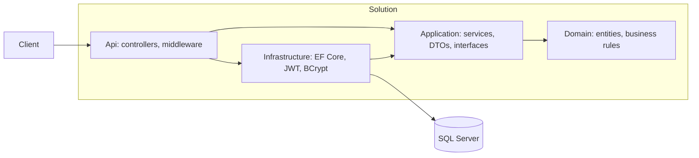

# OrderFlow: Order Management API

[](https://github.com/Jagruti345/orderflow-order-management-system/actions/workflows/ci.yml)

A REST API for e-commerce order management (catalog, customers, orders) built with
**ASP.NET Core 8**, **Entity Framework Core** and **SQL Server**, following **Clean Architecture**.

## Features

- Product catalog with search, stock filter and pagination
- Orders with a state machine: `Pending → Paid → Shipped`, or `Cancelled` (stock is restored)
- JWT authentication, BCrypt password hashing, roles (`Admin`, `Customer`)
- Ownership rules: customers can only see and manage their own orders
- No overselling: optimistic concurrency with a SQL Server `rowversion`
- Serilog structured logging, rate limiting, output caching, liveness and readiness health checks
- Consistent error responses (RFC 7807 `ProblemDetails`) with a trace id
- Docker, Docker Compose, and a GitHub Actions pipeline

## Architecture



Dependencies point inward. `Domain` references nothing, and `Application` only knows interfaces
(for example `IApplicationDbContext`, `IJwtTokenGenerator`), which `Infrastructure` implements.

## Quick start (Docker)

Requires Docker Desktop.

```bash
cp .env.example .env     # then edit the values
docker compose up --build -d
```

- API and Swagger UI: http://localhost:8080/swagger
- Health: `/health/live` and `/health/ready`

Log in with the `ADMIN_EMAIL` and `ADMIN_PASSWORD` from your `.env`.

## Run locally without Docker for the API

1. Start SQL Server: `docker run -e ACCEPT_EULA=Y -e "MSSQL_SA_PASSWORD=<password>" -p 1433:1433 -d mcr.microsoft.com/mssql/server:2022-latest`
2. Set secrets (stored outside Git):
```bash
   dotnet user-secrets init --project src/OrderFlow.Api
   dotnet user-secrets set "ConnectionStrings:DefaultConnection" "<connection string>" --project src/OrderFlow.Api
   dotnet user-secrets set "Jwt:Key" "<random string, 32+ characters>" --project src/OrderFlow.Api
   dotnet user-secrets set "Seed:AdminEmail" "admin@orderflow.local" --project src/OrderFlow.Api
   dotnet user-secrets set "Seed:AdminPassword" "<password>" --project src/OrderFlow.Api
```
3. Apply migrations and run:
```bash
   dotnet ef database update --project src/OrderFlow.Infrastructure --startup-project src/OrderFlow.Api
   dotnet run --project src/OrderFlow.Api
```

## API overview

| Endpoint | Access |
|---|---|
| `POST /api/auth/register`, `POST /api/auth/login` | Public, rate limited |
| `GET /api/products`, `GET /api/products/{id}` | Public |
| `POST /api/products`, `PUT /api/products/{id}` | Admin |
| `GET /api/customers` | Admin |
| `GET/POST /api/orders`, `POST /api/orders/{id}/pay`, `/cancel` | Logged-in user (own orders only) |
| `POST /api/orders/{id}/ship` | Admin |

## Testing

```bash
dotnet test                                    # everything (needs SQL Server for integration tests)
dotnet test --filter "Category!=Integration"   # fast tests only
```

- **Unit tests:** domain rules, password hashing, token generation
- **Service tests:** Moq and the EF Core in-memory provider
- **Integration tests:** `WebApplicationFactory` against a real SQL Server, covering 401/403 rules,
  order ownership, pagination, and a race where five buyers compete for the last item

## Design decisions

- **Domain logic lives in entities.** `Order.AddItem` and `Product.DecreaseStock` enforce the rules, so no caller can break them.
- **Concurrency:** a `rowversion` on `Product` makes SQL Server reject conflicting updates; the API returns `409`.
- **Security:** the role is never chosen by the caller, login errors don't reveal which emails exist, and another user's order returns `404`.
- **Configuration:** secrets come from user secrets or environment variables, never from the repository.

## Known limitations and next steps

- Access tokens can't be revoked; add refresh tokens
- Migrations run at startup in Docker; a separate migration job is safer with many replicas
- Rate limiting by IP needs forwarded-headers configuration behind a proxy
- No payment integration; `pay` only changes the order status
- No automated cloud deployment yet